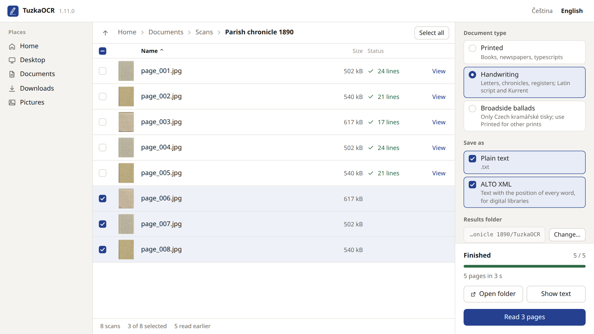

# Step by step, no experience needed

This page assumes you have never used a command line and do not want to learn one. It gets
you from a fresh computer to OCR'd pages.

Setup takes about 5 minutes and you do it **once**: copy one line into a terminal. After
that, you type `tuzkaocr app` and do everything else with the mouse, in a window in your web
browser — pick a folder of scans, tick the pages, press a button.

!!! info "What you will be typing into"
    A **terminal** (also called Command Prompt, or Terminal) is a window where you type a
    line, press <kbd>Enter</kbd>, and the computer does it. It looks bare, but you cannot
    break anything by typing the lines on this page.

    **Copy and paste** the lines rather than retyping them.

## Before you start: will this work on your computer?

| Your computer | Will it work? |
|---|---|
| Windows | Yes |
| Linux | Yes |
| Mac with an Apple chip (M1, M2, M3, M4…) | Yes |
| Mac with an Intel processor | **No** — see below |

To check a Mac: click the  Apple menu in the top-left corner, then **About This Mac**. If
it says **Chip: Apple M…**, you are fine. If it says **Processor: … Intel …**, this page
will not work on that machine — the software it depends on is no longer published for
Intel Macs. Ask whoever supports your IT about the [Docker option](docker.md), or use a
different computer.

## Step 1 — Open a terminal

=== "Windows"

    Press the <kbd>Windows</kbd> key, type `cmd`, and press <kbd>Enter</kbd>. A black
    window opens.

=== "Mac"

    Press <kbd>⌘</kbd><kbd>Space</kbd>, type `terminal`, and press <kbd>Enter</kbd>.

=== "Linux"

    Open **Terminal** from your applications menu.

## Step 2 — Install TuzkaOCR

Copy this one line into the terminal and press <kbd>Enter</kbd>:

=== "Windows"

    ```bat
    powershell -ExecutionPolicy ByPass -c "irm https://moravianlibrary.github.io/TuzkaOCR/install.ps1 | iex"
    ```

=== "Mac / Linux"

    ```bash
    curl -LsSf https://moravianlibrary.github.io/TuzkaOCR/install.sh | sh
    ```

It installs [uv](https://docs.astral.sh/uv/), a small free installer, which then fetches the
right Python, the newest TuzkaOCR and its models — a few hundred megabytes, a few minutes.
It has worked when the last lines say
**`TuzkaOCR … is installed`**.

Now **close the terminal window and open a new one**, as in step 1 — only a new window knows
about `tuzkaocr`.

!!! note "On a work computer"
    If the line is refused or blocked, your IT department restricts installing software.
    Send them a link to this page, or use [the way without uv](#without-uv), which needs
    Python installed instead.

## Step 3 — Start the app

In the new terminal window, type:

```bash
tuzkaocr app
```

Your web browser opens TuzkaOCR on its own. The app runs on your computer only — nothing is
uploaded, and it works without an internet connection.



**Leave the terminal window open** while you work; it is what runs the app. When you are
done, close it, or press <kbd>Ctrl</kbd>+<kbd>C</kbd> in it.

If the browser does not open by itself, the terminal shows a line starting with
`http://127.0.0.1:` — copy the whole line into your browser's address bar.

## Step 4 — Read your first pages

1. **Find your scans.** Use the places on the left — *Home*, *Desktop*, *Documents*,
   *Downloads*, *Pictures*, and any USB drives — and click folders to open them. The path
   at the top takes you back up. The app shows only images it can read: JPEG, PNG and
   TIFF.
2. **Tick the pages** you want to read, or click **Select all**. Click a column title —
   *Name*, *Size*, *Status* — to sort by it.
3. **Choose the document type** on the right. This matters more than anything else:
   reading handwriting with the printed setting, or the other way round, gives nonsense.

    | Your material | Choose |
    |---|---|
    | Printed books, newspapers, typescripts — most scans | **Printed** |
    | Letters, chronicles, registers; Latin script or German Kurrent | **Handwriting** |
    | Czech kramářské tisky (broadside ballads), and nothing else | **Broadside ballads** |

4. **Choose what to save.** *Plain text* is what you read; *ALTO XML* records where every
   word sits on the page, which digital libraries and viewers need. Keep both if unsure.
5. Press **Read … pages**.

A bar shows the progress and the time left. The first page takes a little longer while the
app loads. You can keep browsing meanwhile; **Stop** finishes the current page and stops.
A page that cannot be read — a damaged file, say — is marked *Failed* and the others carry
on.

When it finishes, **Show text** puts each scan next to its text, and **Open folder** shows
the files.

!!! note "On a Mac: *Terminal would like to access files in your Documents folder*"
    macOS asks once per folder such as Documents, Desktop or Downloads, naming the terminal
    app you started TuzkaOCR from — Terminal, or iTerm if you use that. Click **Allow**. If
    it was refused once, macOS stops asking and the app says *macOS is blocking this
    folder*; turn the folder on in **System Settings → Privacy & Security → Files &
    Folders →** your terminal app, then quit the terminal and start `tuzkaocr app` again.

## Where the results go

Next to your scans, in a new folder called `TuzkaOCR`. Reading
`Chronicle/page_001.jpg` writes `Chronicle/TuzkaOCR/page_001.txt` and
`page_001.alto.xml`. Your scans are never changed.

To put the results somewhere else, click **Change…** next to the results folder, pick or
create a folder, and click **Use this folder**. From then on results from every scan folder
go there, until you click **Go back to the default**. If you cannot save into the scans
folder — a CD or a read-only network drive — the results go to your Documents folder
instead, and the app says so.

## Coming back later

Open a terminal (step 1) and type `tuzkaocr app` again. The app remembers your last folder
and settings. Pages read earlier show *Read*, with a **View** link.

## Updating to a new version

Run the [step 2](#step-2-install-tuzkaocr) line again. It always installs the newest
release, replacing the old one.

## Your own model

If your institution gave you a custom model — a file ending in `.tpack` — copy it into
the folder below, then start the app again. It appears as an extra document type.

=== "Windows"

    `%USERPROFILE%\.local\share\tuzkaocr\domains\`

=== "Mac / Linux"

    `~/.local/share/tuzkaocr/domains/`

[Custom domain packs](custom-domains.md) has the details.

## When something looks wrong

| What you see | What it means |
|---|---|
| `command not found` / `is not recognized` | Installed with the step 2 line: open a new terminal window — windows opened before the install do not see it. Installed [without uv](#without-uv): the `(.venv)` marker is missing from your prompt; re-run the [activate line](#coming-back-tomorrow). |
| The browser shows *TuzkaOCR has stopped* | The terminal window was closed. Open one and type `tuzkaocr app`. |
| The browser says the page cannot be reached | Same: the app is not running. Start it again; it opens a new page. |
| *macOS is blocking this folder* | See the Mac note in [step 4](#step-4-read-your-first-pages). |
| *This folder cannot be opened* | Your account may not read it — a colleague's or a system folder, for example. |
| The text is gibberish | Wrong document type for the material. See [step 4](#step-4-read-your-first-pages). |
| The text is mostly right but words are mangled | Likely the scan itself. Below roughly 200 dpi, no setting rescues it. |
| A page is marked *Failed* | Hover over *Failed* to see why. Usually the file is damaged or not really an image. |
| `running scripts is disabled on this system` (Windows) | Only when installing [without uv](#without-uv): you are in PowerShell. Use Command Prompt instead — the `cmd` trick — or ask IT to allow local scripts. |

If you need to ask someone for help, send them a **screenshot of the browser window** and
the **last 20 lines** the terminal printed. Those two things resolve most questions
immediately.

## Prefer typing commands?

Everything the app does is also a single typed line, which is handy for scripts or for
thousands of pages. Open a terminal in the folder with your scans first:

=== "Windows"

    Open the folder in File Explorer, click once on the **address bar** at the top, type
    `cmd` over what is there and press <kbd>Enter</kbd>.

=== "Mac"

    Type `cd` and a space in Terminal, drag the folder from Finder onto the window, and
    press <kbd>Enter</kbd>.

=== "Linux"

    Right-click the folder and choose **Open in Terminal**.

One page, as text:

```bash
tuzkaocr page.jpg --format txt --out page.txt
```

Add `--domain handwritten` for handwriting or `--domain kramarky` for kramářské tisky.
Quote file names that contain spaces: `"scan 001.jpg"`. A whole folder, as text and ALTO:

```bash
tuzkaocr scans --batch --format multi --out-dir results
```

Leave the window open while it runs; add `--workers 1` if the computer becomes sluggish.
[Command line](cli.md) lists every option.

## Other ways to install

Use these only if the step 2 line does not work on your computer.

### With uv, by hand

The step 2 line does exactly this. Install uv:

=== "Windows"

    ```bat
    powershell -ExecutionPolicy ByPass -c "irm https://astral.sh/uv/install.ps1 | iex"
    ```

=== "Mac / Linux"

    ```bash
    curl -LsSf https://astral.sh/uv/install.sh | sh
    ```

Close the terminal, open a new one, and install TuzkaOCR. Put the newest version from the
[latest release page](https://github.com/moravianlibrary/TuzkaOCR/releases/latest) in place
of `v1.11.0`:

```bash
uv tool install --force --python 3.13 https://github.com/moravianlibrary/TuzkaOCR/archive/refs/tags/v1.11.0.zip
```

Keep `--python 3.13` in the line. Without it uv picks the newest Python, 3.15, which
TuzkaOCR does not support yet. To update, run the same line with the new version.

### Without uv

The slowest way: you install Python yourself, and every new terminal window needs one extra
line before `tuzkaocr` works.

!!! warning "Python 3.15 does not work yet"
    TuzkaOCR runs on Python 3.11 to 3.14. The newest Python, 3.15, is not supported until
    `onnxruntime`, a library TuzkaOCR depends on, is published for it. The first step below
    shows how to pick 3.14 instead of the newest version.

#### Install Python

Python is the language TuzkaOCR is written in; it does not come with Windows and is often
outdated on Macs.

=== "Windows"

    1. Go to [python.org/downloads/windows](https://www.python.org/downloads/windows/).
    2. Find the newest release whose name starts with **Python 3.14** and click
       **Windows installer (64-bit)** under it. Do not use the big yellow button on the
       main downloads page — it gives you Python 3.15, which does not work yet.
    3. Run the file it gives you.
    4. **Important:** on the installer's first screen, tick the box at the bottom that says
       **Add python.exe to PATH**, then click *Install Now*.

    That checkbox is easy to miss and everything later fails without it. If you have already
    installed Python without it, run the installer again and choose *Modify*.

=== "Mac"

    1. Go to [python.org/downloads/macos](https://www.python.org/downloads/macos/).
    2. Find the newest release whose name starts with **Python 3.14** and click
       **macOS 64-bit universal2 installer** under it. Do not use the big yellow button on
       the main downloads page — it gives you Python 3.15, which does not work yet.
    3. Open the file it gives you and click through the installer, accepting the defaults.

=== "Linux"

    Python is almost certainly already installed. Skip to the next step — you will check
    in a moment anyway.

#### Download TuzkaOCR

1. Open the **[latest release page](https://github.com/moravianlibrary/TuzkaOCR/releases/latest)**.
2. Scroll down to the **Assets** section and click **Source code (zip)**.
3. Unzip the file you downloaded. You get a folder named after the version — release
   v1.7.1, for example, unzips to a folder called `TuzkaOCR-1.7.1`.
4. Move that folder somewhere you can find again. Your Documents folder is fine.

This page always shows the newest published version, so the link stays correct as new
versions come out. Every past version is listed on the
[all releases page](https://github.com/moravianlibrary/TuzkaOCR/releases), which is where to
go if a colleague asks you to use a specific one.

!!! warning "Not the green *Code* button"
    The green **Code → Download ZIP** button on the repository's front page gives you
    whatever is being worked on *right now*, which may be halfway through a change. A
    release is a version that was finished and published on purpose. Use the release.

The rest of this page calls that unzipped folder **the TuzkaOCR folder**, since its exact
name changes with the version.

#### Open a terminal in that folder

The terminal needs to be "looking at" the TuzkaOCR folder.

=== "Windows"

    1. Open the TuzkaOCR folder in File Explorer, so you can see the files inside it
       (`cli.py`, `README.md`, and so on).
    2. Click once on the **address bar** at the top — the strip showing the folder path.
    3. Type `cmd` over what is there and press <kbd>Enter</kbd>.

    A black window opens, already pointed at the right folder.

=== "Mac"

    1. Open **Terminal** (press <kbd>⌘</kbd><kbd>Space</kbd>, type `terminal`, press
       <kbd>Enter</kbd>).
    2. Type `cd` followed by a single space — do not press Enter yet.
    3. Drag the TuzkaOCR folder from Finder onto the Terminal window. The path fills
       itself in.
    4. Now press <kbd>Enter</kbd>.

=== "Linux"

    Right-click the TuzkaOCR folder and choose **Open in Terminal**.

To confirm Python arrived safely, type this and press <kbd>Enter</kbd>:

=== "Windows"

    ```bat
    python --version
    ```

=== "Mac / Linux"

    ```bash
    python3 --version
    ```

You should see something like `Python 3.14.2`. Any version from **3.11 to 3.14** is fine.
**3.15 or newer will not work** — go back to [Install Python](#install-python) and install 3.14 alongside it. If you
instead see "command not found" or "not recognized", Python is not installed correctly — on
Windows that is nearly always the missing PATH checkbox from the first step.

#### One-time setup

Two lines to prepare a private space for TuzkaOCR's files, then one to install it. Run them
in order.

=== "Windows"

    ```bat
    python -m venv .venv
    ```

    ```bat
    .venv\Scripts\activate
    ```

    ```bat
    pip install .
    ```

=== "Mac / Linux"

    ```bash
    python3 -m venv .venv
    ```

    ```bash
    source .venv/bin/activate
    ```

    ```bash
    pip install .
    ```

The third line prints a wall of text for a minute or two as it downloads what it needs.
That is normal. It has worked when you see a line beginning **`Successfully installed`**.

!!! note "The `(.venv)` marker"
    After the second line, your terminal prompt gains a `(.venv)` prefix. That marker means
    TuzkaOCR is available in this window. It matters later — see [coming back
    tomorrow](#coming-back-tomorrow).

Check it worked:

```bash
tuzkaocr --help
```

A list of options means you are done setting up.

Then type `tuzkaocr app` and continue with [step 4](#step-4-read-your-first-pages). To
update, download the new release and repeat these steps in its folder.

#### Coming back tomorrow

This is the one thing that confuses everybody. Each **new** terminal window starts fresh,
so you have to re-enter the folder and re-activate before `tuzkaocr` exists again:

=== "Windows"

    ```bat
    .venv\Scripts\activate
    ```

=== "Mac / Linux"

    ```bash
    source .venv/bin/activate
    ```

You do **not** repeat `pip install .` — that was genuinely one-time. If you get
`command not found` after reopening the terminal, you have simply skipped this line.

## Next steps

- [CLI reference](cli.md) — every available option, once you want more control
- [Troubleshooting](troubleshooting.md) — the technical version of the table above
- [Models and domains](models.md) — what each document type was built for
