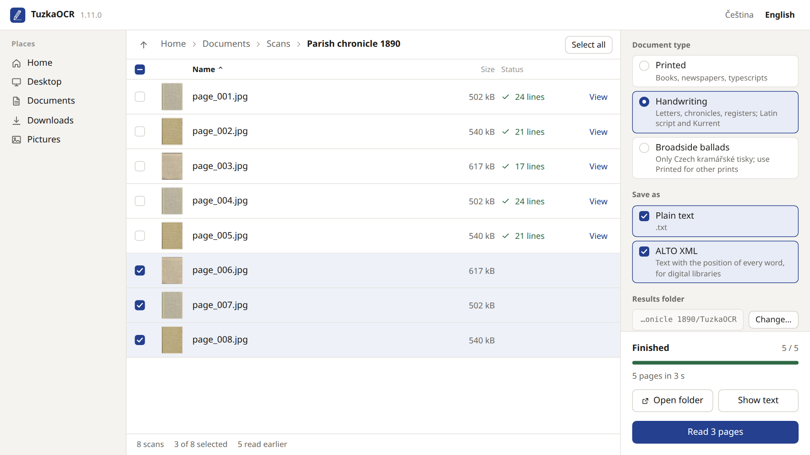

# Krok za krokem, bez předchozích zkušeností (Strojový překlad z anglické verze návodu)

Tento návod je pro ty, kdo nikdy nepracovali s příkazovým řádkem a ani se to učit
nechtějí. Provede vás vším od instalace až po hotový text ze skenů.

Instalace trvá asi 5 minut a děláte ji **jen jednou**: stačí do terminálu vložit jeden
příkaz. Pak už jen napíšete `tuzkaocr app` a vše ostatní obstaráte myší ve webovém
prohlížeči — vyberete složku se skeny, zaškrtnete stránky a kliknete na tlačítko.

!!! info "Co je terminál"
    **Terminál** (také příkazový řádek nebo Command Prompt) je okno, do kterého se píšou
    příkazy. Napíšete příkaz, stisknete <kbd>Enter</kbd> a počítač ho provede. Působí
    nevlídně, ale příkazy z tohoto návodu vám nic nepokazí.

    Příkazy **kopírujte a vkládejte**, nepřepisujte je ručně.

!!! note "Jazyk aplikace"
    Pokud máte prohlížeč nastavený na češtinu nebo slovenštinu, aplikace se sama zobrazí
    česky. Jinak ji přepnete tlačítkem **Čeština** vpravo nahoře; aplikace si volbu
    zapamatuje. Návod uvádí české popisky.

## Než začnete: bude to na vašem počítači fungovat? { #nez-zacnete }

| Váš počítač | Funguje? |
|---|---|
| Windows | Ano |
| Linux | Ano |
| Mac s čipem Apple (M1, M2, M3, M4…) | Ano |
| Mac s procesorem Intel | **Ne** — viz níže |

Jak to zjistit na Macu: klikněte v levém horním rohu na nabídku  Apple a zvolte
**O tomto Macu** (*About This Mac*). Pokud vidíte **Čip: Apple M…**, je vše v pořádku.
Pokud vidíte **Procesor: … Intel …**, na tomto počítači návod fungovat nebude — knihovny,
na kterých TuzkaOCR závisí, už pro Macy s procesorem Intel nevycházejí. Zeptejte se svého
IT oddělení na [variantu s Dockerem](docker.md), nebo použijte jiný počítač.

## Krok 1 — Otevřete terminál { #krok-1 }

Vyberte svůj systém — **Windows**, **Mac** nebo **Linux**.

=== "Windows"

    Stiskněte klávesu <kbd>Windows</kbd>, napište `cmd` a stiskněte <kbd>Enter</kbd>.
    Otevře se černé okno.

=== "Mac"

    Stiskněte <kbd>⌘</kbd><kbd>mezerník</kbd>, napište `terminal` a stiskněte
    <kbd>Enter</kbd>.

=== "Linux"

    Otevřete **Terminál** z nabídky aplikací.

## Krok 2 — Nainstalujte TuzkaOCR { #krok-2 }

Zkopírujte do terminálu tento příkaz a stiskněte <kbd>Enter</kbd>:

=== "Windows"

    ```bat
    powershell -ExecutionPolicy ByPass -c "irm https://moravianlibrary.github.io/TuzkaOCR/install.ps1 | iex"
    ```

=== "Mac"

    ```bash
    curl -LsSf https://moravianlibrary.github.io/TuzkaOCR/install.sh | sh
    ```

=== "Linux"

    ```bash
    curl -LsSf https://moravianlibrary.github.io/TuzkaOCR/install.sh | sh
    ```

Příkaz nainstaluje [uv](https://docs.astral.sh/uv/), malý bezplatný instalační nástroj,
který pak stáhne správnou verzi Pythonu, nejnovější TuzkaOCR i s modely. Jde o několik
set megabajtů, takže to chvíli trvá. Instalace je hotová, když se na konci vypíše
**`TuzkaOCR … is installed`**.

Potom **okno terminálu zavřete a otevřete nové** (stejně jako v kroku 1). Příkaz
`tuzkaocr` funguje až v nově otevřeném okně.

!!! note "Na pracovním počítači"
    Pokud počítač příkaz odmítne nebo zablokuje, vaše IT oddělení nejspíš omezuje
    instalaci programů. Pošlete jim odkaz na tuto stránku, nebo zkuste
    [instalaci bez uv](#bez-uv), pro kterou ale potřebujete mít nainstalovaný Python.

## Krok 3 — Spusťte aplikaci { #krok-3 }

V novém okně terminálu napište:

```bash
tuzkaocr app
```

TuzkaOCR se sama otevře ve webovém prohlížeči. Aplikace běží jen na vašem počítači —
nic se nikam neodesílá a funguje i bez internetu.



**Okno terminálu nechte po celou dobu práce otevřené**, aplikace běží právě v něm. Až
budete hotovi, zavřete ho, nebo v něm stiskněte <kbd>Ctrl</kbd>+<kbd>C</kbd>.

Pokud se prohlížeč neotevře sám, najděte v terminálu řádek začínající
`http://127.0.0.1:` a celý ho zkopírujte do adresního řádku prohlížeče.

## Krok 4 — Převeďte první stránky na text { #krok-4 }

1. **Najděte své skeny.** V levém panelu jsou zkratky *Domovská složka*, *Plocha*,
   *Dokumenty*, *Stažené soubory*, *Obrázky* a připojené USB disky. Složky otevíráte
   kliknutím, přes cestu nahoře se vrátíte zpět. Aplikace zobrazuje jen obrázky, které
   umí zpracovat: JPEG, PNG a TIFF.
2. **Zaškrtněte stránky**, které chcete zpracovat, nebo klikněte na **Vybrat vše**.
   Kliknutím na záhlaví sloupce — *Název*, *Velikost*, *Stav* — podle něj seznam
   seřadíte.
3. **Vpravo vyberte typ dokumentu.** Na této volbě záleží nejvíc: když rukopis zpracujete
   s nastavením pro tisk nebo naopak, vyjde nesmyslný text.

    | Váš materiál | Zvolte |
    |---|---|
    | Tištěné knihy, noviny, strojopisy — většina skenů | **Tisk** |
    | Dopisy, kroniky, matriky; latinka i německý kurent | **Rukopis** |
    | Pouze kramářské tisky | **Kramářské tisky** |

4. **V části Uložit jako vyberte formát.** *Prostý text* je text ke čtení. *ALTO XML*
   navíc zaznamenává, kde přesně na stránce které slovo leží; ten potřebují digitální
   knihovny a prohlížeče. Pokud si nejste jisti, nechte zaškrtnuté obojí.
5. Klikněte na **Přečíst … stran**.

Ukazatel průběhu zobrazuje, kolik je hotovo a kolik času zbývá. První stránka trvá déle,
protože se aplikace teprve načítá. Mezitím můžete dál procházet složky. Tlačítko
**Zastavit** nechá dokončit rozpracovanou stránku a pak zpracování zastaví. Pokud
některou stránku nejde zpracovat, třeba kvůli poškozenému souboru, označí se stavem
*Chyba* a ostatní se zpracují normálně.

Po dokončení zobrazí **Zobrazit text** každý sken vedle rozpoznaného textu a **Otevřít
složku** otevře složku s výsledky.

!!! note "Na Macu: *Terminal would like to access files in your Documents folder*"
    macOS se u složek jako Dokumenty, Plocha nebo Stažené soubory jednou zeptá, zda smí
    terminál (Terminál, případně iTerm, pokud ho používáte) k souborům přistupovat.
    Klikněte na **Allow** (povolit). Pokud jste přístup jednou odmítli, macOS se už
    neptá a aplikace hlásí *macOS tuto složku blokuje*. Přístup pak povolte
    v **Nastavení systému → Soukromí a zabezpečení → Soubory a složky →** vaše aplikace
    terminálu, terminál ukončete a znovu spusťte `tuzkaocr app`.

## Kam se ukládají výsledky { #kam-se-ukladaji-vysledky }

Do nové složky `TuzkaOCR` vedle vašich skenů. Ze souboru `Kronika/strana_001.jpg` tak
vznikne `Kronika/TuzkaOCR/strana_001.txt` a `strana_001.alto.xml`. Samotné skeny se
nikdy nemění.

Pokud chcete výsledky ukládat jinam, klikněte v části *Složka s výsledky* na
**Změnit…**, vyberte nebo vytvořte složku a klikněte na **Použít tuto složku**. Od té
chvíle se tam ukládají výsledky ze všech složek se skeny, dokud nekliknete na **Vrátit
výchozí**. Pokud do složky se skeny
nejde zapisovat (CD, síťový disk jen pro čtení), uloží se výsledky do složky Dokumenty
a aplikace vás na to upozorní.

## Když se k práci vrátíte { #kdyz-se-vratite }

Otevřete terminál (krok 1) a znovu napište `tuzkaocr app`. Aplikace si pamatuje
naposledy otevřenou složku i nastavení. Už zpracované stránky mají stav *Přečteno*
a tlačítko **Zobrazit**.

## Aktualizace na novou verzi { #aktualizace }

Spusťte znovu příkaz z [kroku 2](#krok-2). Vždy nainstaluje nejnovější verzi místo té
staré.

## Odinstalace { #odinstalace }

TuzkaOCR odstraníte tímto příkazem v terminálu:

```bash
uv tool uninstall tuzkaocr
```

Vaše skeny i složky `TuzkaOCR` s výsledky zůstanou na svém místě. Pokud je už
nepotřebujete, smažte je ručně.

Pokud jste uv instalovali jen kvůli TuzkaOCR, můžete odstranit i uv a Python, který
stáhl. Pokud uv používáte i k něčemu jinému, tento krok vynechte. Příkazy spouštějte
postupně, jeden po druhém:

=== "Windows"

    V **PowerShellu** (stiskněte klávesu <kbd>Windows</kbd>, napište `powershell`
    a stiskněte <kbd>Enter</kbd>):

    ```powershell
    uv cache clean
    ```

    ```powershell
    Remove-Item -Recurse -Force "$(uv python dir)", "$(uv tool dir)"
    ```

    ```powershell
    Remove-Item -Force -ErrorAction SilentlyContinue "$HOME\.local\bin\uv.exe", "$HOME\.local\bin\uvx.exe", "$HOME\.local\bin\uvw.exe"
    ```

    Pokud jste uv instalovali přes winget, použijte místo posledního příkazu
    `winget uninstall --id=astral-sh.uv -e`.

=== "Mac"

    ```bash
    uv cache clean
    ```

    ```bash
    rm -rf "$(uv python dir)" "$(uv tool dir)"
    ```

    ```bash
    rm -f ~/.local/bin/uv ~/.local/bin/uvx
    ```

    Pokud jste uv instalovali přes Homebrew, použijte místo posledního příkazu
    `brew uninstall uv`.

=== "Linux"

    ```bash
    uv cache clean
    ```

    ```bash
    rm -rf "$(uv python dir)" "$(uv tool dir)"
    ```

    ```bash
    rm -f ~/.local/bin/uv ~/.local/bin/uvx
    ```

Malý soubor `env` ve stejné složce nemažte: terminál ho načítá při každém spuštění a bez
něj by každé nové okno hlásilo chybu.
Pokud jste přidali [vlastní model](#vlastni-model), smažte také složku `tuzkaocr`
v `.local/share`.

## Vlastní model { #vlastni-model }

Pokud vám vaše instituce poskytla vlastní model (soubor s příponou `.tpack`), zkopírujte
ho do složky uvedené níže a aplikaci spusťte znovu. Objeví se v ní jako další typ
dokumentu.

=== "Windows"

    `%USERPROFILE%\.local\share\tuzkaocr\domains\`

=== "Mac"

    `~/.local/share/tuzkaocr/domains/`

=== "Linux"

    `~/.local/share/tuzkaocr/domains/`

Podrobnosti najdete na stránce [Custom domain packs](custom-domains.md) (anglicky).

## Když něco nefunguje { #kdyz-neco-nefunguje }

| Co vidíte | Co to znamená |
|---|---|
| `command not found` / `is not recognized` | Instalace příkazem z kroku 2: otevřete nové okno terminálu, okna otevřená před instalací o TuzkaOCR nevědí. Instalace [bez uv](#bez-uv): na začátku řádku chybí značka `(.venv)`; spusťte znovu [aktivační příkaz](#zitra-znovu). |
| Prohlížeč ukazuje *TuzkaOCR už neběží* | Okno terminálu bylo zavřeno. Otevřete nové a napište `tuzkaocr app`. |
| Prohlížeč hlásí, že stránku nelze zobrazit | Totéž: aplikace neběží. Spusťte ji znovu, otevře se v nové stránce. |
| *macOS tuto složku blokuje* | Viz poznámku pro Mac v [kroku 4](#krok-4). |
| *Tuto složku nelze otevřít* | Váš účet do složky nejspíš nemá přístup — například jde o složku jiného uživatele nebo systémovou složku. |
| Text je nesmyslný | Zvolili jste špatný typ dokumentu. Viz [krok 4](#krok-4). |
| Text je většinou správný, ale některá slova jsou zkomolená | Nejspíš je problém v samotném skenu. Pod zhruba 200 dpi už nepomůže žádné nastavení. |
| Stránka má stav *Chyba* | Najeďte myší na *Chyba* a zobrazí se důvod. Obvykle je soubor poškozený nebo to ve skutečnosti není obrázek. |
| `running scripts is disabled on this system` (Windows) | Nastává jen při instalaci [bez uv](#bez-uv): jste v PowerShellu. Použijte místo něj příkazový řádek (`cmd`), nebo požádejte IT o povolení místních skriptů. |

Pokud potřebujete pomoc, napište nám:

- Filip Bím — [filip.bim@mzk.cz](mailto:filip.bim@mzk.cz)
- Martina Dvořáková — [dvorakovam@mzk.cz](mailto:dvorakovam@mzk.cz)

Přiložte **snímek obrazovky z prohlížeče** a **posledních 20 řádků** výpisu z terminálu.
Díky tomu většinu dotazů vyřešíme hned.

## Raději píšete příkazy? { #prikazy }

Všechno, co umí aplikace, lze spustit i jediným příkazem. To se hodí pro skripty nebo
pro tisíce stránek. Nejprve otevřete terminál ve složce se skeny:

=== "Windows"

    Otevřete složku v Průzkumníku souborů, klikněte jednou do **adresního řádku** nahoře,
    napište místo cesty `cmd` a stiskněte <kbd>Enter</kbd>.

=== "Mac"

    V Terminálu napište `cd` a mezeru, přetáhněte do okna složku z Finderu a stiskněte
    <kbd>Enter</kbd>.

=== "Linux"

    Klikněte na složku pravým tlačítkem a zvolte **Otevřít v terminálu**.

Jedna stránka jako text:

```bash
tuzkaocr page.jpg --format txt --out page.txt
```

Pro rukopis přidejte `--domain handwritten`, pro kramářské tisky `--domain kramarky`.
Názvy souborů s mezerami dejte do uvozovek: `"sken 001.jpg"`. Celá složka jako text
i ALTO:

```bash
tuzkaocr scans --batch --format multi --out-dir results
```

Dokud příkaz běží, nechte okno otevřené. Pokud se počítač příliš zpomalí, přidejte
`--workers 1`. Všechny volby najdete na stránce [CLI](cli.md) (anglicky).

## Další způsoby instalace { #dalsi-zpusoby-instalace }

Použijte je, jen pokud vám příkaz z kroku 2 nefunguje.

### Ručně pomocí uv { #s-uv-rucne }

Příkaz z kroku 2 dělá přesně totéž. Nejprve nainstalujte uv:

=== "Windows"

    ```bat
    powershell -ExecutionPolicy ByPass -c "irm https://astral.sh/uv/install.ps1 | iex"
    ```

=== "Mac"

    ```bash
    curl -LsSf https://astral.sh/uv/install.sh | sh
    ```

=== "Linux"

    ```bash
    curl -LsSf https://astral.sh/uv/install.sh | sh
    ```

Pokud na Macu používáte [Homebrew](https://brew.sh), funguje i `brew install uv`, na
Windows `winget install --id=astral-sh.uv -e`. Příkaz z kroku 2 pak takto nainstalované
uv použije a nebude stahovat vlastní, takže ho po instalaci uv můžete rovnou spustit.

Zavřete terminál, otevřete nový a nainstalujte TuzkaOCR. Místo `v1.11.1` doplňte
nejnovější verzi ze [stránky posledního vydání](https://github.com/moravianlibrary/TuzkaOCR/releases/latest):

```bash
uv tool install --force --python 3.13 https://github.com/moravianlibrary/TuzkaOCR/archive/refs/tags/v1.11.1.zip
```

Část `--python 3.13` v příkazu nechte. Bez ní by uv zvolilo nejnovější Python 3.15, který
TuzkaOCR zatím nepodporuje. Aktualizujete stejným příkazem s novým číslem verze.

### Bez uv { #bez-uv }

Nejpracnější cesta: Python si nainstalujete sami a v každém novém okně terminálu musíte
před použitím `tuzkaocr` spustit jeden příkaz navíc.

!!! warning "Python 3.15 zatím nefunguje"
    TuzkaOCR běží na Pythonu 3.11 až 3.14. Nejnovější Python 3.15 bude podporovaný, až pro
    něj vyjde knihovna `onnxruntime`, na které TuzkaOCR závisí. V prvním kroku níže je
    popsáno, jak místo nejnovější verze stáhnout 3.14.

#### Nainstalujte Python { #nainstalujte-python }

TuzkaOCR je napsaná v jazyce Python. Windows ho nemají v základu a na Macu bývá
zastaralý.

=== "Windows"

    1. Otevřete [python.org/downloads/windows](https://www.python.org/downloads/windows/).
    2. Najděte nejnovější vydání, jehož název začíná **Python 3.14**, a klikněte pod ním
       na **Windows installer (64-bit)**. Nepoužívejte velké žluté tlačítko na hlavní
       stránce stahování — to stáhne Python 3.15, který zatím nefunguje.
    3. Spusťte stažený soubor.
    4. **Důležité:** na první obrazovce instalátoru zaškrtněte dole políčko **Add
       python.exe to PATH** a pak klikněte na *Install Now*.

    Toto políčko se snadno přehlédne a bez něj později nic nebude fungovat. Pokud už jste
    Python nainstalovali bez něj, spusťte instalátor znovu a zvolte *Modify*.

=== "Mac"

    1. Otevřete [python.org/downloads/macos](https://www.python.org/downloads/macos/).
    2. Najděte nejnovější vydání, jehož název začíná **Python 3.14**, a klikněte pod ním
       na **macOS 64-bit universal2 installer**. Nepoužívejte velké žluté tlačítko na
       hlavní stránce stahování — to stáhne Python 3.15, který zatím nefunguje.
    3. Otevřete stažený soubor a projděte instalací s výchozím nastavením.

=== "Linux"

    Python máte téměř jistě nainstalovaný. Pokračujte dalším krokem, za chvíli si to
    ověříte.

#### Stáhněte TuzkaOCR { #stahnete-tuzkaocr }

1. Otevřete **[stránku posledního vydání](https://github.com/moravianlibrary/TuzkaOCR/releases/latest)**.
2. Sjeďte dolů do části **Assets** a klikněte na **Source code (zip)**.
3. Stažený soubor rozbalte. Vznikne složka pojmenovaná podle verze — například vydání
   v1.7.1 se rozbalí do složky `TuzkaOCR-1.7.1`.
4. Přesuňte tuto složku někam, kde ji snadno najdete, třeba do Dokumentů.

Odkaz vede vždy na nejnovější vydanou verzi, takže platí i po vydání dalších verzí.
Všechny starší verze najdete na
[stránce všech vydání](https://github.com/moravianlibrary/TuzkaOCR/releases) — tam se
podívejte, pokud vás kolega požádá o konkrétní verzi.

!!! warning "Nepoužívejte zelené tlačítko *Code*"
    Zelené tlačítko **Code → Download ZIP** na hlavní stránce repozitáře stáhne aktuální
    rozpracovaný stav, který může obsahovat nedokončené změny. Vydání (release) je verze,
    která byla dokončena a zveřejněna. Stahujte vždy vydání.

Dál v návodu této rozbalené složce říkáme **složka TuzkaOCR**, protože její přesný název
se s každou verzí mění.

#### Otevřete terminál v této složce { #terminal-ve-slozce }

Terminál musí být otevřený přímo ve složce TuzkaOCR.

=== "Windows"

    1. Otevřete složku TuzkaOCR v Průzkumníku souborů tak, abyste viděli soubory uvnitř
       (`cli.py`, `README.md` a další).
    2. Klikněte jednou do **adresního řádku** nahoře, tedy do pruhu s cestou ke složce.
    3. Napište místo cesty `cmd` a stiskněte <kbd>Enter</kbd>.

    Otevře se černé okno, které už je ve správné složce.

=== "Mac"

    1. Otevřete **Terminál** (stiskněte <kbd>⌘</kbd><kbd>mezerník</kbd>, napište
       `terminal` a stiskněte <kbd>Enter</kbd>).
    2. Napište `cd` a jednu mezeru — Enter zatím nemačkejte.
    3. Přetáhněte složku TuzkaOCR z Finderu do okna Terminálu. Cesta se doplní sama.
    4. Teď stiskněte <kbd>Enter</kbd>.

=== "Linux"

    Klikněte na složku TuzkaOCR pravým tlačítkem a zvolte **Otevřít v terminálu**.

Ověřte, že se Python nainstaloval správně. Napište následující příkaz a stiskněte
<kbd>Enter</kbd>:

=== "Windows"

    ```bat
    python --version
    ```

=== "Mac"

    ```bash
    python3 --version
    ```

=== "Linux"

    ```bash
    python3 --version
    ```

Měli byste vidět něco jako `Python 3.14.2`. Vyhovuje jakákoli verze od **3.11 do 3.14**.
**Verze 3.15 a novější fungovat nebudou** — vraťte se k [instalaci
Pythonu](#nainstalujte-python) a nainstalujte k ní ještě verzi 3.14. Pokud se místo toho
vypíše „command not found“ nebo „not recognized“, Python není správně nainstalovaný. Na
Windows je to téměř vždy kvůli nezaškrtnutému políčku PATH z prvního kroku.

#### Jednorázové nastavení { #jednorazove-nastaveni }

První dva příkazy vytvoří pro TuzkaOCR samostatné prostředí, třetí do něj TuzkaOCR
nainstaluje. Spusťte je v tomto pořadí.

=== "Windows"

    ```bat
    python -m venv .venv
    ```

    ```bat
    .venv\Scripts\activate
    ```

    ```bat
    pip install .
    ```

=== "Mac"

    ```bash
    python3 -m venv .venv
    ```

    ```bash
    source .venv/bin/activate
    ```

    ```bash
    pip install .
    ```

=== "Linux"

    ```bash
    python3 -m venv .venv
    ```

    ```bash
    source .venv/bin/activate
    ```

    ```bash
    pip install .
    ```

Třetí příkaz minutu až dvě vypisuje spoustu textu, protože stahuje vše potřebné. To je
v pořádku. Hotovo je, když se objeví řádek začínající **`Successfully installed`**.

!!! note "Značka `(.venv)`"
    Po druhém příkazu se na začátku řádku v terminálu objeví `(.venv)`. Tato značka
    znamená, že je TuzkaOCR v tomto okně k dispozici. Budete ji potřebovat i později —
    viz [Při dalším spuštění](#zitra-znovu).

Ověřte, že vše funguje:

```bash
tuzkaocr --help
```

Pokud se vypíše seznam voleb, je nastavení hotové.

Pak napište `tuzkaocr app` a pokračujte [krokem 4](#krok-4). Při aktualizaci stáhněte
nové vydání a tyto kroky zopakujte v jeho složce.

#### Při dalším spuštění { #zitra-znovu }

Tady chybuje skoro každý. Každé **nové** okno terminálu začíná od nuly. Než budete moct
použít `tuzkaocr`, musíte terminál znovu otevřít ve složce TuzkaOCR a znovu aktivovat
prostředí:

=== "Windows"

    ```bat
    .venv\Scripts\activate
    ```

=== "Mac"

    ```bash
    source .venv/bin/activate
    ```

=== "Linux"

    ```bash
    source .venv/bin/activate
    ```

Příkaz `pip install .` už **neopakujte**, ten byl opravdu jen jednorázový. Pokud po
otevření nového terminálu dostanete `command not found`, zapomněli jste spustit právě
tento příkaz.

## Co dál { #co-dal }

Následující stránky jsou zatím jen v angličtině:

- [CLI](cli.md) — všechny dostupné volby, až budete chtít víc možností
- [Troubleshooting](troubleshooting.md) — podrobnější technická verze tabulky výše
- [Models and domains](models.md) — k čemu je který typ dokumentu určený
